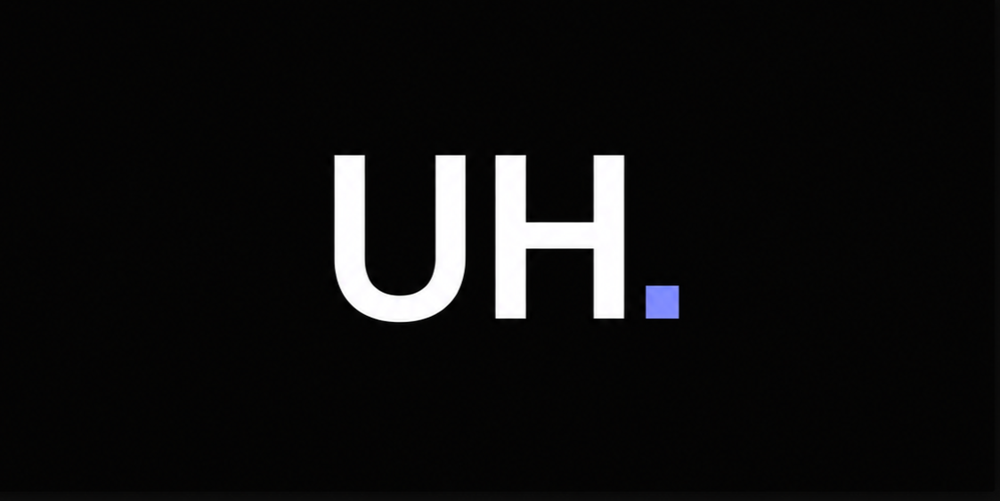

# ubayd.me

Source for [ubayd.me](https://ubayd.me), my personal site: projects, blog posts, education and a contact page.



## What is on it

- **Projects** (`/projects`): each project has a card, and the larger ones have their own page with screenshots, metrics and links.
- **Blog** (`/blog`): write-ups of what I built and what went wrong along the way.
- **About, Education, Skills, Contact.**

Project and post content lives in two typed files, [app/projects/projects.ts](app/projects/projects.ts) and [app/blog/posts.ts](app/blog/posts.ts). Pages, the sitemap, metadata and JSON-LD structured data are all generated from them, so adding a project means adding one entry.

## Stack

Next.js (App Router), React, TypeScript, Tailwind CSS and Framer Motion. Hosted on Vercel. Every page is statically generated at build time.

## Run it locally

Needs Node 20 or newer.

```bash
npm install
npm run dev
```

Then open http://localhost:3000.

## Checks

```bash
npm run typecheck
npm run lint
npm run build
```

CI runs the same three on every push and pull request.

## Layout

- `app/`: routes. Each route has a server `page.tsx` (metadata) and a client component (UI).
- `components/`: navbar, footer, theme toggle, breadcrumbs.
- `lib/`: structured-data helpers.
- `public/`: images, CV and the Open Graph image.

## License

[MIT](LICENSE)
